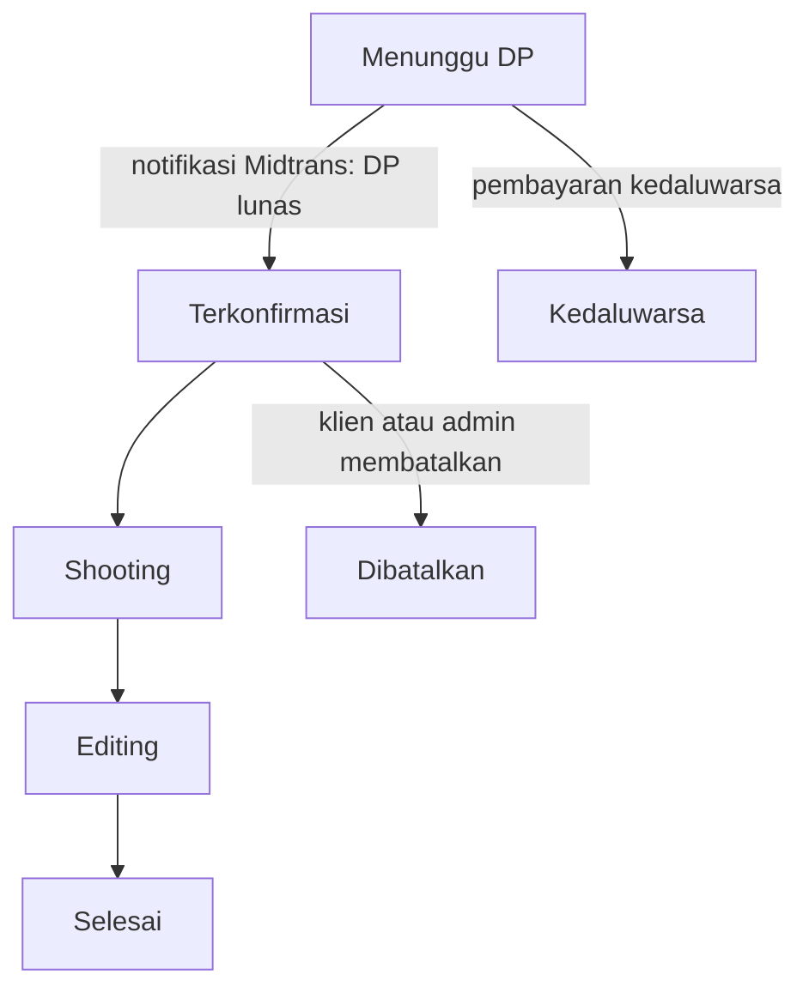
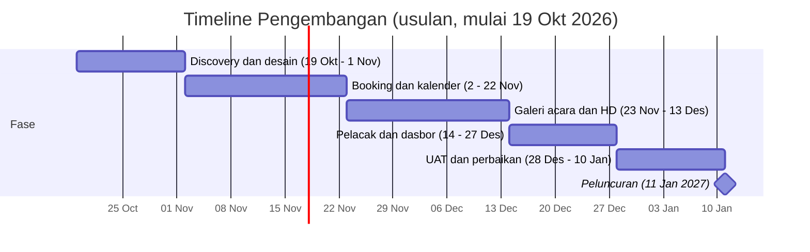

# PRD MujaPhotography: Web Portofolio Digital dan Distribusi Galeri Acara

13 Oktober 2026 (direvisi 20 Oktober 2026: pembayaran via Midtrans) · Penyusun: Bima Satria Putra

Judul proyek: **Pengembangan Web Portofolio Digital dan Sistem Distribusi Galeri Acara untuk Mitra UMKM MujaPhotography**

## Ringkasan Produk

**muja_photography** adalah platform web dinamis yang menyatukan portofolio, daftar harga, reservasi sesi privat, dan galeri foto acara publik milik MujaPhotography (Instagram: [@muja_photography_](https://www.instagram.com/muja_photography_/)) dalam satu alamat. Fotografer tidak lagi mencatat jadwal lewat chat dan membagikan foto lewat tautan awan; klien dan peserta acara mengurus jadwal, status, dan pencarian foto mereka sendiri.

Tiga keputusan awal membentuk produk ini:

- Booking sesi privat memakai kalender anti-bentrok. DP dibayar online lewat payment gateway Midtrans, dan pesanan menjadi Terkonfirmasi otomatis saat pembayaran lunas.
- Foto acara publik tampil sebagai preview ber-watermark. Foto resolusi tinggi (HD) berbayar lewat Midtrans, dan tautan unduh terbuka otomatis setelah lunas.
- Filter "jam melintas" memakai data jam yang diinput admin saat mengunggah album, bukan metadata kamera.

## Latar Belakang dan Problem

MujaPhotography melayani dua jenis pekerjaan yang butuh alur berbeda: sesi privat (wedding, pre-wedding, personal) dan peliputan acara publik (sunmori, night ride). Keduanya kini berjalan lewat chat dan tautan awan, sehingga tiga masalah muncul berulang.

| Problem | Dampak | Jawaban di produk |
| --- | --- | --- |
| Jadwal sesi privat dicatat manual lewat chat | Risiko bentrok jadwal, balasan lambat, klien tidak tahu tanggal mana yang kosong | Kalender reservasi interaktif dengan pengecekan bentrok otomatis |
| Peserta acara publik harus mencari foto di antara ribuan berkas tautan awan | Foto sulit ditemukan, peserta menyerah atau bertanya satu per satu ke fotografer | Galeri per album dengan filter rentang jam melintas |
| Portofolio dan daftar harga tersebar di beberapa tempat | Kesan kurang profesional, calon klien bertanya harga berulang kali | Satu situs berisi portofolio terkurasi dan daftar paket harga |
| Klien tidak bisa memantau progres pengerjaan | Banyak pertanyaan "sudah sampai mana" lewat chat | Pelacak status pesanan dengan kode unik |

## Tujuan dan Metrik Keberhasilan

Produk dianggap berhasil bila jadwal tidak lagi bentrok, foto mudah ditemukan, dan fotografer menghemat waktu administrasi. Angka target di bawah adalah usulan awal dan perlu disepakati dengan mitra.

| Tujuan | Metrik | Target usulan |
| --- | --- | --- |
| Menghilangkan bentrok jadwal | Jumlah booking ganda pada slot yang sama | 0 per bulan |
| Memindahkan reservasi ke web | Persentase booking sesi privat yang masuk lewat web | 70% dalam 3 bulan setelah rilis |
| Mempercepat pencarian foto acara | Waktu peserta menemukan fotonya | Kurang dari 2 menit |
| Mengurangi pertanyaan status lewat chat | Jumlah chat "sudah sampai mana" per bulan | Turun 50% |
| Menaikkan kesan profesional | Calon klien yang membuka halaman portofolio dan harga sebelum memesan | Diukur lewat analitik, dasar ukur diambil di bulan pertama |
| Membuka pemasukan baru dari foto acara | Jumlah pembelian foto HD per album | Dasar ukur diambil dari 3 album pertama |

## Target User dan Persona

Produk melayani tiga peran. Pemilik UMKM (fotografer lepas) memakai dashboard admin, sedangkan klien privat dan peserta acara memakai situs publik tanpa wajib membuat akun.

| Peran | Siapa | Kebutuhan utama | Hambatan saat ini |
| --- | --- | --- | --- |
| Fotografer / Admin | Pemilik MujaPhotography, UMKM fotografer lepas | Jadwal rapi, pembayaran DP tercatat otomatis, unggah album cepat, portofolio terkurasi | Mencatat jadwal dan membalas chat satu per satu |
| Klien privat | Pasangan wedding atau pre-wedding, klien sesi personal | Tahu tanggal kosong, melihat paket dan harga, memantau progres | Harus bertanya via chat dan menunggu balasan |
| Peserta acara publik | Komunitas dan peserta sunmori, night ride | Menemukan foto diri sendiri, mengunduh foto HD | Ribuan berkas di tautan awan tanpa urutan yang jelas |

Peserta acara dan klien privat cenderung membuka situs dari ponsel, jadi seluruh halaman publik dirancang mobile-first.

## Ruang Lingkup

MVP mencakup empat fitur utama dari brief ditambah halaman pendukung yang dibutuhkan agar alurnya utuh.

**Termasuk dalam MVP**

- Halaman beranda, portofolio terkurasi, dan daftar paket harga.
- Kalender reservasi sesi privat dengan pengecekan bentrok dan pembayaran DP lewat Midtrans.
- Galeri acara publik per album dengan filter rentang jam, preview ber-watermark, dan pembelian foto HD lewat Midtrans.
- Pelacak status pesanan lewat kode unik (Menunggu DP, Terkonfirmasi, Shooting, Editing, Selesai).
- Integrasi Midtrans: pembayaran Snap dan endpoint notifikasi yang memperbarui status pesanan otomatis.
- Dashboard admin: pantau booking dan status pembayaran, unggah album dan input jam foto, kurasi portofolio, pembaruan status.

**Di luar MVP**

- Refund otomatis lewat API (refund diproses manual lewat dashboard Midtrans).
- Pengenalan wajah untuk mencari foto peserta.
- Aplikasi mobile native.
- Notifikasi WhatsApp otomatis lewat API resmi.
- Akun login untuk klien dan peserta.

**Kandidat fase berikutnya**

- Refund otomatis lewat API Midtrans.
- Notifikasi WhatsApp otomatis.
- Pencarian foto berbasis wajah.

## User Journey

Setiap peran punya satu alur utama dari membuka situs sampai tujuannya selesai.

**Klien privat**

1. Membuka situs dan melihat portofolio serta daftar paket.
2. Memilih paket, lalu memilih tanggal dan jam di kalender. Slot yang sudah terisi tidak bisa dipilih.
3. Mengisi data diri dan lokasi, lalu mengirim pesanan.
4. Membayar DP lewat Midtrans dengan metode yang diaktifkan, lalu menerima kode unik.
5. Memantau status (Menunggu DP, Terkonfirmasi, Shooting, Editing, Selesai) lewat kode unik.

**Peserta acara publik**

1. Membuka situs dan memilih album acara.
2. Memfilter foto berdasarkan rentang jam melintas.
3. Melihat preview ber-watermark dan memilih foto miliknya.
4. Memesan foto HD dan membayar lewat Midtrans.
5. Menerima akses unduhan HD otomatis setelah pembayaran lunas.

**Fotografer (admin)**

1. Masuk ke dashboard.
2. Memeriksa booking baru dan status pembayaran DP, serta membatalkan booking bila perlu.
3. Mengunggah album acara dan mengisi jam foto, serta mengelola portofolio.
4. Memantau pesanan foto HD beserta pembayarannya, dan mengirim ulang tautan unduh bila diminta.
5. Memperbarui status pengerjaan setiap pesanan.

## Kebutuhan Fungsional

Prioritas memakai skala MoSCoW: Must (wajib di MVP), Should (sangat diharapkan), Could (bila waktu cukup).

| ID | Modul | Kebutuhan | Prioritas |
| --- | --- | --- | --- |
| FR-01 | Situs publik | Beranda dengan ringkasan layanan, portofolio pilihan, dan tombol booking | Must |
| FR-02 | Situs publik | Halaman portofolio dengan filter kategori (wedding, pre-wedding, personal, acara) | Must |
| FR-03 | Situs publik | Halaman daftar paket dan harga yang dikelola admin | Must |
| FR-04 | Reservasi | Kalender menampilkan slot kosong, terisi, dan diblokir per tanggal dan jam | Must |
| FR-05 | Reservasi | Formulir pesanan: paket, tanggal, jam, nama, kontak, lokasi, catatan | Must |
| FR-06 | Reservasi | Sistem menolak slot yang sudah terisi, termasuk saat dua klien memesan hampir bersamaan | Must |
| FR-07 | Reservasi | Slot ditahan sementara selama klien membayar DP, lalu dilepas bila pembayaran kedaluwarsa | Must |
| FR-08 | Reservasi | Pembayaran DP lewat Midtrans Snap dengan order ID unik per pesanan | Must |
| FR-09 | Pelacak | Kode unik pesanan dibuat otomatis saat pesanan dikirim | Must |
| FR-10 | Pelacak | Halaman cek status dengan input kode unik, menampilkan tahapan dan waktu pembaruan | Must |
| FR-11 | Galeri acara | Daftar album acara dengan nama, tanggal, dan lokasi | Must |
| FR-12 | Galeri acara | Filter foto berdasarkan rentang jam melintas di dalam satu album | Must |
| FR-13 | Galeri acara | Preview foto ber-watermark yang dibuat otomatis saat unggah | Must |
| FR-14 | Galeri acara | Pemesanan foto HD, pembayaran lewat Midtrans Snap, dan tautan unduh yang terbuka otomatis setelah lunas | Must |
| FR-15 | Dashboard | Login admin dan sesi aman | Must |
| FR-16 | Dashboard | Daftar booking masuk dengan status pembayaran DP, serta pembatalan booking dengan alasan | Must |
| FR-17 | Dashboard | Pengelolaan slot: blokir tanggal, atur jam kerja, batas sesi per hari | Must |
| FR-18 | Dashboard | Unggah album acara secara massal dan input jam per foto atau per kelompok foto | Must |
| FR-19 | Dashboard | Daftar pesanan foto HD dengan status pembayaran dan pengiriman ulang tautan unduh | Must |
| FR-20 | Dashboard | Kurasi portofolio: tambah, ubah urutan, sembunyikan, hapus | Must |
| FR-21 | Dashboard | Perbarui status pesanan (Shooting, Editing, Selesai) | Must |
| FR-22 | Dashboard | Ubah daftar paket dan harga | Should |
| FR-23 | Dashboard | Tombol "hubungi via WhatsApp" dengan pesan terisi otomatis berisi kode pesanan | Should |
| FR-24 | Dashboard | Ringkasan pendapatan dan jumlah booking per bulan | Could |
| FR-25 | Pembayaran | Endpoint notifikasi Midtrans menerima status pembayaran, memverifikasi signature key, dan memperbarui status pesanan tanpa diproses dua kali | Must |
| FR-26 | Pembayaran | Halaman hasil pembayaran (berhasil, tertunda, gagal) setelah klien kembali dari Midtrans | Must |
| FR-27 | Dashboard | Tombol cek status pembayaran yang menanyakan ke API Midtrans bila notifikasi terlambat | Should |

## Kebutuhan Non-Fungsional

| Aspek | Kebutuhan |
| --- | --- |
| Performa | Galeri memuat thumbnail ringan dengan lazy loading; halaman publik terbuka kurang dari 3 detik di jaringan seluler biasa |
| Mobile-first | Seluruh halaman publik nyaman dipakai di layar ponsel; kalender dan filter jam bisa dioperasikan dengan jari |
| Keamanan | Password admin di-hash; server key Midtrans disimpan di file .env dan tidak tampil di browser; notifikasi Midtrans diverifikasi dengan signature key; foto HD asli tidak dapat diakses lewat URL publik; tautan unduh bersifat sementara dan terikat pesanan; validasi tipe dan ukuran berkas unggahan |
| Anti-bentrok | Pengecekan slot dilakukan di server dengan kunci unik di basis data, bukan hanya di tampilan |
| Perlindungan data | Data diri klien (nama, kontak, lokasi) hanya terlihat oleh admin dan pemilik kode pesanan |
| Kode unik | Cukup panjang dan acak agar tidak mudah ditebak, serta dibatasi jumlah percobaan cek per alamat IP |
| SEO | Judul dan deskripsi per halaman, gambar portofolio dengan teks alternatif, tautan yang bisa dibagikan ke media sosial |
| Aksesibilitas | Kontras warna memadai, label formulir jelas, kalender dapat dioperasikan dengan keyboard |
| Ketersediaan | Cadangan basis data berkala; penyimpanan foto terpisah dari server aplikasi |
| Kemudahan admin | Dashboard dapat dipakai dari ponsel, karena fotografer sering bekerja di lapangan |

## Aturan Bisnis dan Alur Status

Kolom Sumber menandai mana aturan yang sudah diputuskan dan mana yang masih usulan untuk dikonfirmasi dengan mitra.

| Aturan | Ketentuan | Sumber |
| --- | --- | --- |
| Anti-bentrok | Dua booking aktif tidak boleh memiliki rentang waktu yang tumpang tindih | Brief |
| Buffer antar sesi | Jeda perjalanan dan persiapan antar sesi, default 60 menit dan bisa diubah admin | Usulan |
| Penahanan slot | Slot ditahan 24 jam setelah pesanan dikirim (sama dengan batas kedaluwarsa pembayaran di Midtrans); bila DP belum lunas, status menjadi Kedaluwarsa dan slot dilepas | Usulan |
| DP sesi privat | Klien membayar DP lewat Midtrans Snap; pesanan menjadi Terkonfirmasi otomatis saat notifikasi Midtrans menyatakan lunas. Nominal DP diatur per paket | Keputusan |
| Kode unik | Dibuat otomatis, contoh format MUJA-7K3P9Q, dipakai untuk cek status | Brief |
| Status pesanan | Menunggu DP, Terkonfirmasi, Shooting, Editing, Selesai; cabang: Dibatalkan, Kedaluwarsa | Brief + usulan |
| Filter jam melintas | Admin mengisi jam per foto atau per kelompok foto saat unggah album; peserta memfilter dengan rentang jam mulai dan selesai | Keputusan |
| Preview foto acara | Semua foto publik tampil ber-watermark dan beresolusi rendah | Keputusan |
| Foto HD | Berbayar; peserta memesan dan membayar lewat Midtrans Snap, lalu akses unduh terbuka otomatis saat notifikasi lunas | Keputusan |
| Harga foto HD | Per foto atau paket beberapa foto, ditetapkan admin per album. Nominal belum ditentukan | Terbuka |
| Tautan unduh HD | Berlaku terbatas (default 7 hari) dan hanya untuk pesanan yang sudah terverifikasi | Usulan |
| Pembayaran Midtrans | Setiap pesanan memakai order ID unik; status pembayaran hanya berubah dari notifikasi Midtrans yang lolos verifikasi signature, dan notifikasi ganda tidak memproses pesanan dua kali | Usulan |
| Pembayaran tidak berhasil | Pembayaran ditolak atau dibatalkan: status tetap Menunggu DP dan klien bisa membayar ulang selama slot ditahan. Pembayaran kedaluwarsa: status menjadi Kedaluwarsa | Usulan |
| Pembayaran masuk setelah slot dilepas | Bila notifikasi lunas tiba setelah slot dilepas dan sudah dipesan orang lain, admin menerima peringatan dan dana dikembalikan secara manual | Usulan |
| Refund | Diproses manual lewat dashboard Midtrans; kebijakan pengembalian DP belum ditentukan | Terbuka |
| Biaya transaksi | Biaya Midtrans per transaksi ditanggung pemilik usaha atau dibebankan ke klien; belum diputuskan | Terbuka |

Pesanan menjadi Terkonfirmasi otomatis saat notifikasi Midtrans menyatakan DP lunas; dua status keluar (Kedaluwarsa dan Dibatalkan) mengembalikan slot ke kalender. Pembayaran yang ditolak atau dibatalkan di Midtrans tidak mengubah status: pesanan tetap Menunggu DP dan klien bisa membayar ulang.

## Struktur Halaman

Situs punya sembilan halaman publik dan satu area dashboard yang dilindungi login.

| Halaman | Rute | Akses | Isi utama |
| --- | --- | --- | --- |
| Beranda | `/` | Publik | Hero, layanan, portofolio pilihan, ajakan booking |
| Portofolio | `/portofolio` | Publik | Grid foto dengan filter kategori |
| Paket dan harga | `/paket` | Publik | Daftar paket, isi paket, harga |
| Booking | `/booking` | Publik | Kalender, pilih paket, formulir, pembayaran DP lewat Midtrans |
| Cek status | `/status` | Publik | Input kode unik dan tampilan tahapan pesanan |
| Daftar album acara | `/acara` | Publik | Kartu album dengan nama, tanggal, lokasi |
| Galeri album | `/acara/{album}` | Publik | Foto ber-watermark, filter rentang jam, pilih foto |
| Pesanan foto HD | `/acara/{album}/pesan` | Publik | Foto terpilih, total harga, pembayaran lewat Midtrans |
| Kontak | `/kontak` | Publik | WhatsApp, Instagram, lokasi kerja |
| Dashboard | `/admin` | Admin | Ringkasan booking dan pesanan yang butuh tindakan |
| Dashboard: Booking | `/admin/booking` | Admin | Daftar booking, status pembayaran DP, ubah status |
| Dashboard: Kalender | `/admin/kalender` | Admin | Blokir tanggal, atur jam kerja |
| Dashboard: Album | `/admin/album` | Admin | Unggah massal, input jam foto, atur harga HD |
| Dashboard: Pesanan foto | `/admin/pesanan-foto` | Admin | Pantau pembayaran, kirim ulang tautan unduh |
| Dashboard: Portofolio dan paket | `/admin/portofolio` | Admin | Kurasi portofolio, ubah paket dan harga |

## Model Data

Sembilan entitas utama mencukupi MVP. Kunci unik pada pasangan tanggal dan jam di tabel Booking menjadi dasar anti-bentrok.

| Entitas | Atribut utama | Relasi |
| --- | --- | --- |
| Admin | id, nama, email, password (hash) | Mengelola semua entitas |
| Paket | id, nama, kategori, deskripsi, harga, nominal DP, durasi | Dipakai oleh Booking |
| Booking | id, kode unik, paket, tanggal, jam mulai, jam selesai, nama klien, kontak, lokasi, catatan, status, waktu dibuat | Milik satu Paket; punya satu atau lebih Pembayaran |
| SlotBlokir | id, tanggal, jam mulai, jam selesai, alasan | Menghalangi pemesanan pada rentang tersebut |
| ItemPortofolio | id, judul, kategori, berkas gambar, urutan, tampil atau sembunyi | Berdiri sendiri |
| Album | id, nama acara, slug, tanggal, lokasi, harga foto HD | Punya banyak Foto |
| Foto | id, album, berkas asli, berkas preview ber-watermark, jam melintas | Milik satu Album; bisa masuk banyak PesananFoto |
| PesananFoto | id, kode unik, kontak pemesan, daftar foto, total, status, kedaluwarsa tautan | Punya satu atau lebih Pembayaran |
| Pembayaran | id, jenis (DP atau foto HD), order ID Midtrans, jumlah, metode, status pembayaran, waktu dibayar | Milik Booking atau PesananFoto |

## Rekomendasi Arsitektur dan Tech Stack

Stack sudah ditetapkan: **Laravel** untuk backend, **MySQL** untuk basis data, dan **Blade** untuk frontend. Pembayaran memakai payment gateway **Midtrans**. Animasi memakai **Animmaster Lib**, library komponen animasi berbasis JavaScript biasa, GSAP, dan WebGL ([ulasan Abduzeedo](https://www.abduzeedo.com/animmaster-studio-releases-high-performance-ui-animation-library)). Karena tidak mewajibkan framework JavaScript, library ini cocok dipasang di halaman Blade.

| Lapisan | Pilihan | Catatan penerapan |
| --- | --- | --- |
| Backend | Laravel | Routing, validasi formulir, autentikasi admin, endpoint notifikasi Midtrans, dan queue untuk pemrosesan foto |
| Basis data | MySQL | Kunci unik pada tanggal dan jam booking, ditambah transaksi dengan penguncian baris untuk anti-bentrok |
| Frontend | Blade | Halaman publik dan dashboard dirender di server; interaksi kalender dan filter jam memakai JavaScript biasa (Alpine.js atau Livewire bila diperlukan) |
| Animasi | Animmaster Lib | Hanya di section tertentu (lihat daftar di bawah) |
| Penyimpanan foto | Storage Laravel | Foto asli di disk privat, preview ber-watermark di disk publik, tautan unduh HD berupa signed URL yang kedaluwarsa |
| Pemrosesan gambar | Intervention Image + queue job | Membuat thumbnail dan watermark di latar saat album diunggah |
| Hosting | VPS kecil | Queue worker butuh proses berjalan terus; bila memakai hosting bersama, queue dijalankan lewat cron; situs wajib memakai HTTPS agar Midtrans dapat mengirim notifikasi |
| Pembayaran | Midtrans Snap | Paket midtrans/midtrans-php untuk membuat transaksi Snap, endpoint notifikasi dengan verifikasi signature key, mode Sandbox selama pengembangan |

**Penggunaan Animmaster Lib**

Animmaster Lib dipakai hanya di landing page dan portofolio, dengan sorotan utama pada efek scrolling di album galeri.

- Dipakai di: hero landing page, portofolio, dan tampilan album galeri, terutama efek scroll saat pengunjung menelusuri foto.
- Tidak dipakai di: kalender reservasi, formulir, pelacak status, dashboard admin, serta kontrol galeri (filter jam, pilih foto, pesan HD), supaya alur transaksi tetap cepat dan jelas.
- Efek berat (terutama WebGL) dimuat hanya saat section terlihat, punya tampilan cadangan statis untuk ponsel lemah, dan menghormati pengaturan "kurangi gerakan" di perangkat. Album berisi ribuan foto tetap memakai lazy loading, dan efek scroll harus tetap lancar setelah filter jam diterapkan.
- Komponen berlabel PRO kemungkinan berlisensi berbayar; lisensi dan harganya dicek sebelum fase desain dikunci.

## Timeline dan Milestone

Fase berjalan berurutan, dan fitur dashboard admin dibangun bersama modul yang dilayaninya. Tanggal mulai 19 Okt 2026 adalah asumsi, sehingga seluruh jadwal bergeser mengikuti kesepakatan dengan mitra.

## Asumsi, Risiko, dan Mitigasi

**Asumsi**

- Satu fotografer utama mengelola semua jadwal, sehingga kalender hanya punya satu kapasitas (satu sesi pada satu waktu).
- Klien dan peserta tidak wajib membuat akun; kode unik pesanan cukup untuk identifikasi.
- Pembayaran DP dan foto HD dilakukan online lewat Midtrans; konfirmasi pembayaran masuk otomatis lewat notifikasi Midtrans, tanpa verifikasi manual admin.
- Isi akun Instagram MujaPhotography belum saya tinjau, jadi nama paket, harga, dan gaya visual masih menunggu data dari mitra.

**Risiko**

| Risiko | Dampak | Mitigasi |
| --- | --- | --- |
| Input jam foto manual memakan waktu untuk album ribuan foto | Admin enggan menginput, filter jam tidak akurat | Input per kelompok foto (rentang jam), bukan per foto; EXIF sebagai fitur tambahan di fase berikutnya |
| Notifikasi pembayaran Midtrans terlambat atau gagal diterima | Peserta sudah membayar tetapi akses foto HD belum terbuka | Tombol cek status ke API Midtrans di dashboard; pemrosesan notifikasi aman dari duplikasi; log setiap notifikasi |
| Biaya transaksi Midtrans memotong pendapatan | Pendapatan bersih lebih kecil dari harga paket | Hitung biaya tiap metode pembayaran sebelum harga final ditetapkan; putuskan siapa yang menanggung biaya |
| Foto diunduh dari preview tanpa membayar | Pendapatan foto HD berkurang | Preview beresolusi rendah dengan watermark; foto asli tidak pernah dikirim ke peramban |
| Biaya penyimpanan membengkak karena ribuan foto per acara | Biaya bulanan melebihi kemampuan UMKM | Kompresi preview, batas retensi album, pilihan menghapus foto asli setelah masa tertentu |
| Peserta merasa foto pribadinya dipajang publik | Keluhan privasi | Admin dapat menyembunyikan foto atau album atas permintaan; ketentuan privasi tampil di halaman galeri |
| Akun Midtrans produksi belum aktif saat rilis | Pembayaran online belum bisa dipakai pelanggan | Ajukan akun bisnis Midtrans lebih awal; uji seluruh alur di Sandbox |
| Pembayaran masuk setelah slot sudah dilepas | Dua klien berebut slot yang sama dan satu dana tertahan | Samakan batas kedaluwarsa pembayaran dengan penahanan slot; refund manual lewat dashboard Midtrans |

## Pertanyaan Terbuka

Hal-hal ini perlu dikonfirmasi dengan MujaPhotography sebelum desain dan pengembangan dikunci.

- [x] Apa saja paket sesi privat, isi tiap paket, durasi, harga, dan nominal DP?
- [ ] Berapa maksimal sesi per hari, jam kerja, dan buffer antar sesi yang diinginkan?
- [ ] Berapa harga foto HD per foto atau per paket, dan berapa lama tautan unduh berlaku?
- [ ] Berapa lama slot ditahan menunggu pembayaran DP (usulan 24 jam)?
- [ ] Berapa rata-rata foto per acara, dan seberapa sering acara publik diadakan?
- [ ] Metode pembayaran Midtrans apa yang diaktifkan (QRIS, e-wallet, virtual account, kartu), dan siapa yang menanggung biaya transaksinya?
- [ ] Apakah sudah ada logo, warna, dan nama domain yang harus dipakai?
- [ ] Apakah ada anggaran hosting dan penyimpanan bulanan yang menjadi batas?
- [ ] Berapa lama waktu pengerjaan yang tersedia dan siapa yang mengerjakan?
- [ ] Apakah fotografer bersedia menyembunyikan foto peserta yang meminta dihapus?
- [ ] Apakah mitra sudah punya akun bisnis Midtrans, dan siapa yang mengurus verifikasi akun produksinya?
- [ ] Bagaimana kebijakan pengembalian DP bila klien membatalkan sesi?
